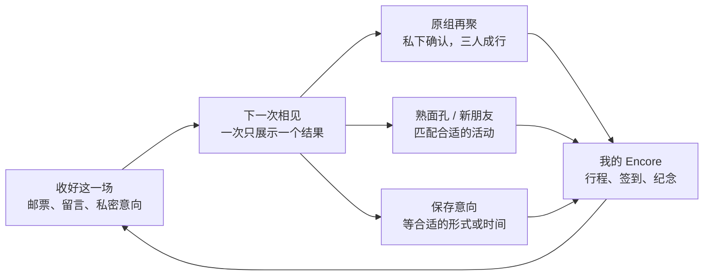

# Encore｜让一次相遇，有下一次

Encore 帮助参加过活动的人，按自己喜欢的形式和关系，再次参与。纪念是回来的理由；合适的下一次相见，才是回来的结果。

原来两版各解决一半问题：

| 原产品 | 原结构 | Encore 保留的能力 |
|---|---|---|
| A 同组再聚 | 散场邀请 → 私下确认 → 三人成行 → 再次参加 | 原组邀请、截止时间、私密承诺、主理人处理、下一次循环 |
| B 再来一场 | 散场回答 → 单一推荐 → 预订 → 到场纪念 | 形式与关系分开选择、互选、排除、换形式、兴趣清单 |

合并后的原组再聚是推荐的一条分支。用户面对一个品牌、一份意向、一张下一次邀请、一份行程和纪念库，不需要选择 A 或 B。

三个页面共用一条回访路径：

1. **收好这一场**：选择画面、裁成齿边邮票、写一句话并私藏；草稿自动保存。分别选择活动形式、同行关系，私密排除单独设置。
2. **下一次相见**：依据意向只展示一个结果。原组邀请在这里完成私下回应；合适的活动在这里预订；条件不合适时保留意向，不催促报名。
3. **我的 Encore**：按参加日期打开活动信封，找回作品与草稿；同一处查看待成行、已确认和已预订行程。签到添加新的信封与邮票，再进入下一次循环。

本版统一扮演林夏。演示起点为 2026 年 11 月 14 日的盲盒晚餐，原组下一场为 11 月 21 日的晚餐；11 月 22 日邮局漫步保留为换形式的选择。这是合并后的新场景，原 A、B 文件保留作设计参照。

形式意向明确锚定这场晚餐：**再来一场晚餐／试试其他形式／先歇一歇**。关系意向独立选择：**原来的小组／熟面孔／新朋友**。sourceEventId 记录意向来自哪次活动；浏览旧作品不会悄悄改变这道题的含义。

| 用户意向或条件 | 展示结果 | 边界 |
|---|---|---|
| 先歇一歇 | 兴趣清单 | 不推活动、预订或倒计时压力 |
| 原组＋晚餐，邀请有效且兼容 | 原组晚餐邀请 | 三人确认前仅本人回应可见 |
| 原组＋其他形式，但主理人仍邀请晚餐 | 私密的原组意向卡 | 保存换形式的期待，不擅自换成新朋友 |
| 主理人改邀兼容的原组漫步 | 原组漫步邀请 | 才进入对应的私下确认流程 |
| 熟面孔且双方互选 | 一位熟面孔的合适活动 | 只向双方告知 |
| 熟面孔但尚未互选 | 形式匹配、可参加的活动 | 保留私下想见意向，不公开单向选择；只有实际互选才揭示姓名 |
| 明确选择新朋友 | 同类或其他形式的新一场 | 分组始终排除不愿同组的人 |

排除是匹配的硬约束，不是公开反馈。原组过期或出现排除冲突，用户看到中性的其他可能，不会得知谁没回复、谁拒绝了或谁排除了谁。形式变化也不自动意味着关系变化。

底层统一为五类对象：

| 对象 | 负责什么 |
|---|---|
| Event | 活动形式、时间、地点、强度、素材与参加记录 |
| ReturnIntent | 来源活动、形式、关系、互选意向与私密排除 |
| GroupInvitation | 原组邀请、回复截止、版本、成行状态与私密回应 |
| Participation | 每人每场唯一的意向、确认、预订和签到；保存约定的分组 |
| Keepsake | 归属于已参加活动的邮票、留言、作品、草稿和分享范围 |

修改意向只影响新的推荐，不改写已预订的熟面孔，也不自动取消现有行程。明确改订替代活动时，才一并处理原组承诺。原组回复截止为 **11 月 17 日 18:00**；目录活动的老朋友优先期截至 **11 月 19 日 12:00**，两种计时分别展示。

Encore 延续米色、黄色、红色与暖橙色的纸本视觉。所有人物、活动、报名和提醒均为本地演示数据，时间使用上海时区。入口为 encore.html，数据统一保存在 encore.demo.v1；存储不可用时改为本页内存演示。
